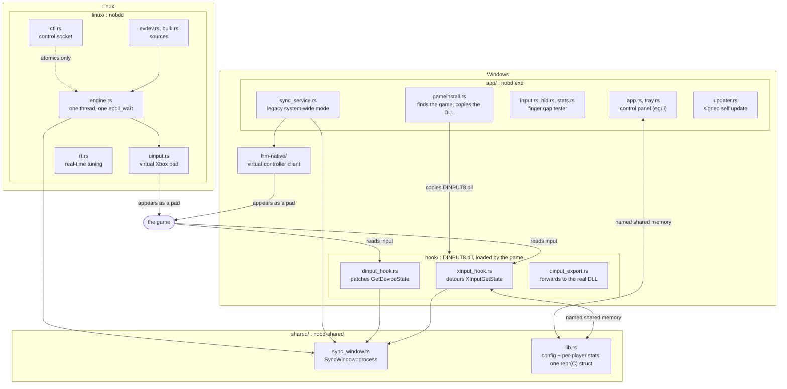
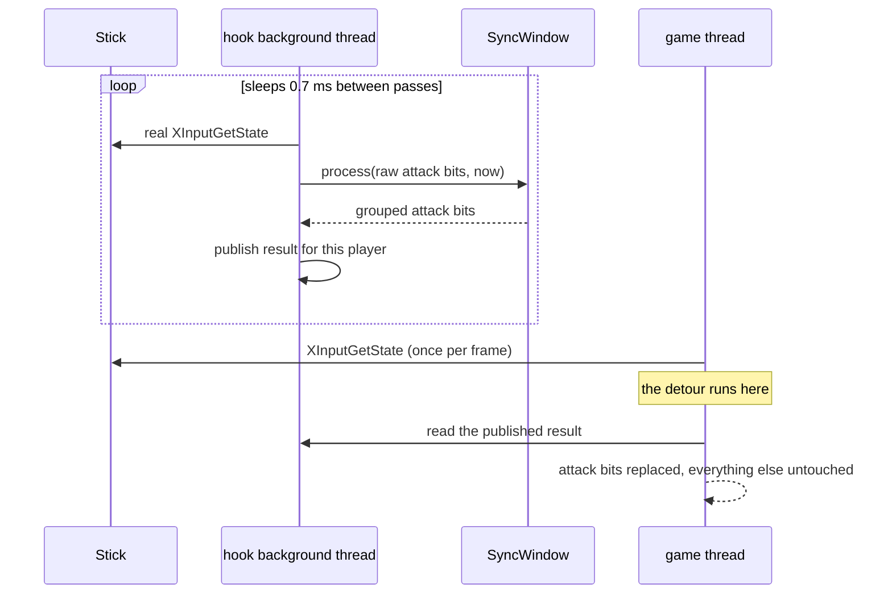

# NOBD Desktop floorplan

A map of this repository for someone opening it cold: what each crate is for, how they connect, and the
path one button press takes on Windows and on Linux.

Written against `master` at `f1802b2` (release `v0.7.1`). Every statement points at a file you can open.
Line numbers will drift; file and function names will not.

## 1. What this is

A stick reports at 1000 Hz and *Marvel vs. Capcom 2* reads its controller once per 60 Hz frame. On Windows
this targets one game build: the *Marvel vs. Capcom Fighting Collection* on Steam (`app/src/gameinstall.rs`). Two
buttons pressed a few milliseconds apart can fall on either side of that read, so a two-button input
arrives as one button, then the other. The [NOBD firmware](https://github.com/t3chnicallyinclined/GP2040-CE-NOBD)
fixes this inside the controller. This repository is the same fix in software, for people who do not want
to flash a board.

There is one algorithm, the **sync window**, and it is written once in `shared/src/sync_window.rs`. Every
other crate is a way of putting that one function between a controller and a game on a particular
platform.

## 2. The floorplan

## 3. The rooms

| Crate | Builds | Lines of Rust | Tests | What it is |
|---|---|---|---|---|
| `shared/` | library | 955 | 22 | The sync window and the shared state. `SyncWindow::process` in `sync_window.rs` is pure: the caller passes the raw buttons, the masks, the current time and the window, and it returns the grouped buttons. It reads no clock and makes no OS calls. `lib.rs` is the config and statistics struct that the app and the hook both map. |
| `hook/` | `DINPUT8.dll` | 1,235 | 11 | The in-game path. The game already loads `DINPUT8.dll`, so this is a replacement that forwards every export to the real one (`dinput_export.rs`) and intercepts `XInputGetState`, which is what this game uses, with a DirectInput fallback. |
| `app/` | `nobd.exe` | 7,109 | 6 | The control panel. It installs the hook into the game folder, shows what the hook measured, runs the finger gap tester, and updates itself. |
| `hm-native/` | library | 1,955 | 7 | A Rust client for the vendored HIDMaestro virtual-controller driver, used by the app's legacy system-wide mode. |
| `linux/` | `nobdd` | 3,528 | 12 | The Linux daemon: reads the real stick, runs the window, and presents a virtual Xbox pad. |

Also in the tree:

- `driver/nobd-hid-filter/` is an earlier design, a Windows HID filter driver in C++. It is a scaffold that
  was never built here. Its `SyncWindow.h` and `test_syncwindow.cpp` are a C++ version of the same window.
- `hidmaestro-sync/` is a C# spike that evaluated the virtual-controller driver before `hm-native` replaced
  it.
- `installer/nobd.nsi` builds the Windows installer. `linux/packaging/` holds the systemd unit, udev rules
  and install script.

## 4. One press on Windows

The default path runs inside the game's own process.

Where each step is:

1. `DllMain` in `hook/src/lib.rs` calls `spawn` in `hook/src/xinput_hook.rs` when the game loads the DLL.
   The game loads XInput lazily, so a thread retries `try_install` for up to a minute until it can detour
   `XInputGetState`.
2. `continuous_poll_loop` runs the window on its own thread, on its own clock. This is the important design
   choice: the game's read never waits on the window. It samples a result that is already committed.
3. `our_xinput_get_state` is the detour. It calls the real function, then `continuous_apply` overwrites only
   the attack bits with the windowed value. `due_now` covers the case where a press has passed its deadline
   but the background thread has not ticked yet. Until the background thread has published once, the
   detour passes the real state through unchanged.
4. `hook/src/dinput_hook.rs` is a fallback for a stick read through DirectInput. It is simpler: it runs the
   window inline inside the game's `GetDeviceState` call, with no background thread.
5. The hook writes what it saw (finger gap, presses grouped, presses that would have split) into the
   shared struct. `nobd.exe` maps the same struct by name and draws it. The two are separate processes and
   share nothing else.

`hook/src/pollprobe.rs` exists to check the assumption all of this rests on: that the game really does
read input once per frame on a steady cadence. It measures that from inside the game at a cost of one
atomic add per call.

There is also an older, system-wide path. Before v0.7.0 the app read the real stick, ran the window, and
presented the result as a virtual controller (`app/src/sync_service.rs`, `hm-native/`, with driver setup in
`app/src/nobd_setup.rs` and stick hiding in `app/src/hidhide.rs`). v0.7.0 moved the fix inside the game so
that no driver is needed (`CHANGELOG.md`). The old path is still in the app, but it only starts if that
virtual controller is already installed, and the app offers to remove it.

## 5. One press on Linux

`nobdd` is one process with one hot thread.

1. A source delivers a report: `linux/src/evdev.rs` for any stick the kernel knows, or
   `linux/src/bulk.rs` for a stick running the NOBD firmware's bulk mode. evdev events carry the kernel's
   own timestamp, so the window is timed from when the kernel saw the report and not from when the daemon
   got scheduled.
2. `linux/src/engine.rs` waits in a single `epoll_wait` on the source, a `timerfd` armed for the exact
   moment the window expires, and a `signalfd`. There is no polling loop.
3. It calls the same `SyncWindow::process` and writes the result to `linux/src/uinput.rs`, a virtual pad that
   presents the identity of a wired Xbox 360 controller.
4. `linux/src/ctl.rs` is a Unix socket on its own thread. It only touches atomics the engine already
   re-reads, so changing the window on a running daemon adds nothing to the hot loop.
5. `linux/src/rt.rs` applies real-time tuning at startup and reports which settings the machine allowed,
   so a latency figure is never quoted on an assumption.

## 6. The contract

Stated at the top of `shared/src/sync_window.rs`, and the thing the tests exist to hold:

- The window changes **when** a press is reported. It never changes **which** buttons are reported.
- Only rising edges of the bits the caller marks as synced are delayed. Every shipped caller marks the
  attack buttons, so directions pass straight through.
- A press is never deleted. A tap shorter than the window still arrives.
- Pulse width is preserved. A release is delayed by the same amount its press was.
- A press is held for at most the window, and delivered early the moment two attacks are held. The first
  button waits only for the finger gap; the second adds no delay.

## 7. How it is checked

| Check | Where | What it covers |
|---|---|---|
| Sync window unit tests | `shared/src/sync_window.rs` (18 tests) | The contract above and its edge cases. |
| C++ version | `driver/nobd-hid-filter/test_syncwindow.cpp` | The C++ window's own cases. Built and run by hand. |
| Hook logic | `hook/src/xinput_hook.rs`, `hook/src/pollprobe.rs` | Deadline handling and the poll cadence statistics, as pure functions. Run locally. |
| Linux CI | `.github/workflows/linux.yml` | `cargo check`, `clippy -D warnings` and `cargo test` for `nobd-linux` and `nobd-shared`, then a smoke test that the binary runs and reports honestly with no stick and no privileges. |
| Kernel constants | tests in `linux/src/` | The ioctl numbers and struct layouts against the values in the real kernel headers. |

CI covers `nobd-linux` and `nobd-shared` only. The Windows crates (`app`, `hook`, `hm-native`) are built and
tested locally. The workspace is never built whole: pick a package, for example
`cargo build -p nobd-app --release` on Windows or `cargo build -p nobd-linux --release` on Linux.

## 8. Where to start reading

- The algorithm: `shared/src/sync_window.rs`, top comment first, then the tests at the bottom.
- The in-game path: `hook/src/xinput_hook.rs`, starting at `spawn` and `continuous_poll_loop`.
- The Linux daemon: the comment at the top of `linux/src/engine.rs`.
- How the two Windows binaries stay in step: `shared/src/lib.rs` for the struct, `app/src/updater.rs` for
  why the app and the DLL are always updated together.
- Using it rather than reading it: `docs/USAGE.md` and `docs/LINUX.md`.
